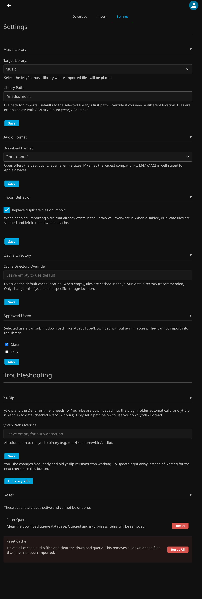
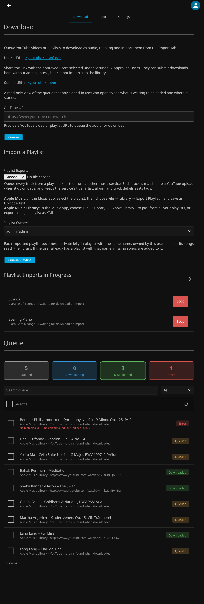
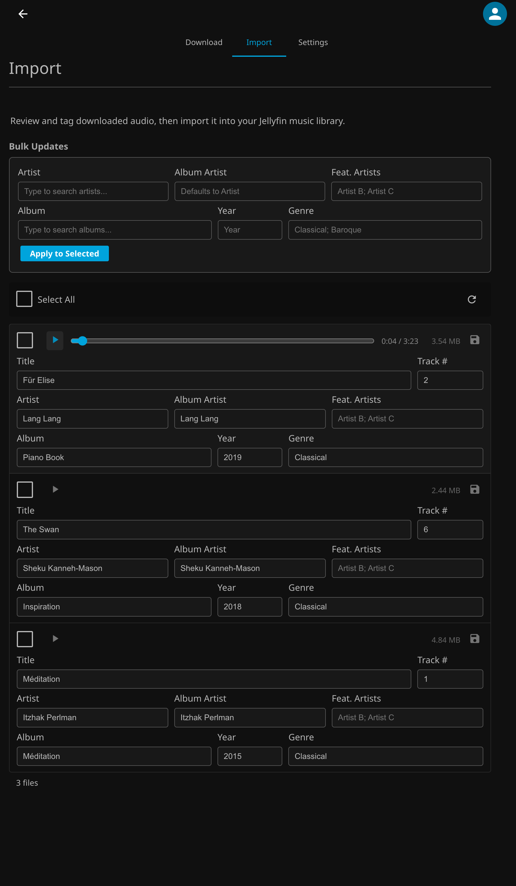
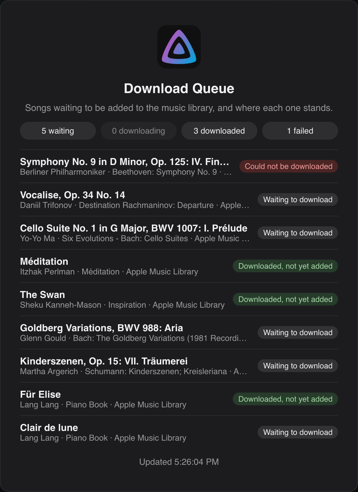
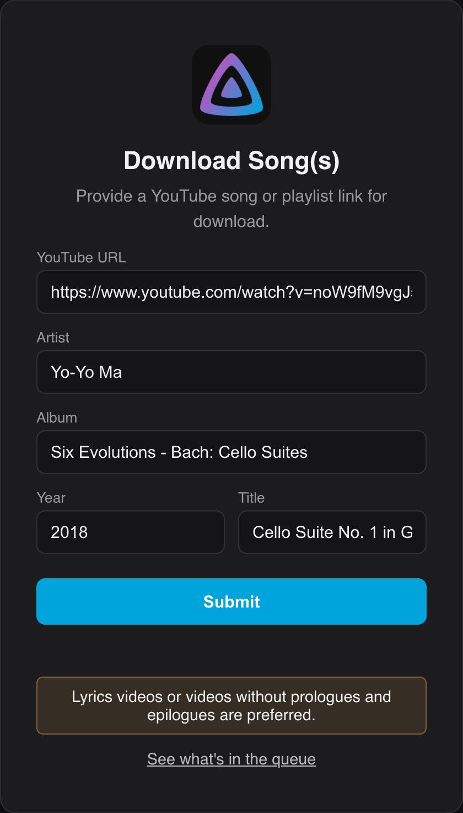

# 

A Jellyfin plugin to download audio tracks from YouTube URLs or playlists. Once downloaded, files are tagged using internal metadata and imported into a local Jellyfin music library.

## How It Works
YouTube Audio lets you paste a YouTube video or playlist URL, download the audio using [YT-DLP](https://github.com/yt-dlp/yt-dlp), tag each track with metadata, and import the files directly into your Jellyfin library. YT-DLP and the [Deno](https://deno.com) JavaScript runtime it needs for YouTube are downloaded into the plugin folder automatically, including in the official Jellyfin Docker image, and yt-dlp is kept up to date; you can point to your own yt-dlp instead in Settings. Downloads that YouTube temporarily refuses are retried automatically, and a failed item can be retried by selecting it on the Download tab and clicking **Download**. Downloaded files are organized into Jellyfin's expected directory structure automatically.

## Getting Started

### 1. Settings

#### Configure the plugin before your first download.

| Settings |
|----------|
|  |

**Music Library** — Select your target Jellyfin music library and confirm the library path. This is the directory where imported files will be placed. Files are organized as:

```
<library path>/Artist/Album (Year)/Song.ext
```

> **Important:** Jellyfin must have write access to this directory for the audio to be copied successfully.

**Audio Format** — Choose your preferred download format:

| Format | Notes |
|--------|-------|
| Opus (.opus) | Best quality at smaller file sizes |
| MP3 (.mp3) | Widest compatibility |
| M4A (.m4a) | Well-suited for Apple devices |

**Import Behavior** — Choose whether importing a file that already exists in the library should overwrite the existing file or skip it (leaving the duplicate in the download cache).

**Cache Directory** — By default, downloaded files are cached in the Jellyfin data directory. Override this if you need a specific staging location.

**Approved Users** — By default, only users with access to the Admin Dashboard can download & import tracks. Enabling a user here allows select users to download tracks into your queue which you then can approve and import into your library.

### 2. Download

#### Queue up audio for download.

| Downloads |
|-----------|
|  |

1. Paste a YouTube video or playlist URL into the input field
2. Click **Queue** to add it to the download queue
3. From the queue, select the items you want to download and click **Download** — or remove any you don't want with **Delete**

#### Import a playlist from another service.

1. Export from the Apple Music app, either:
   - one playlist: select it and choose **File → Library → Export Playlist…** (Unicode Text or XML), or
   - your whole library: choose **File → Library → Export Library…**, which lets you pick any of your playlists, or the entire library, in the next step
2. Pick the **Playlist Owner**: each imported playlist becomes a private Jellyfin playlist with the same name, owned by that user (choose "Don't create playlists" to only download). Then, under **Playlist Export**, choose the file and click **Queue Playlist**. For a library export, tick the playlists you want and click **Queue Selected**; a track in more than one selected playlist is queued once. Every track is added to the queue with its title, artist, album, genre, composer, year and track and disc numbers from the export (and its album artist, from a library or XML export)
   - Album names are cleaned so every edition groups as one album: labels like "(Deluxe Edition)", "(Remastered)", "(Bonus Track Version)", " - Single" and " - EP" are removed, while ones naming a different recording ("Live", "Orchestral Version") are kept. "feat." artists are moved out of titles and tagged as featured artists
   - Nothing is queued twice: songs already in your Jellyfin library or the queue are skipped, and a song appearing more than once keeps its best version (album, then compilation, then EP, then single). If your library only has a song's single and the import brings its album version, the album version is queued and the single's file is deleted once it is imported
   - New tracks from an album you already have reuse that album's name and year, so they land in its existing folder
   - The owner's playlist fills in as songs reach the library: songs you already have are added straight away, the rest once they are downloaded, imported and scanned. If the owner already has a playlist with that name, only the songs it is missing are added, and its songs are put in the export's order (songs the owner added themselves keep their place). Each import is one-time: it finishes once every song is in, or once a song's download fails or is removed. Re-importing later simply adds what is new and re-orders
3. Download as usual. Each track is matched to a YouTube upload when it downloads, preferring the artist's own channel and an upload close to the track's length. A match worth checking (a length difference over 3 seconds, or an upload not from the artist) is noted on the queue row, and a track with no acceptable upload is marked as an error

### 3. Import

#### Tag your downloaded files and bring them into your library.

| Import |
|--------|
|  |

1. Review and edit metadata for each downloaded file (title, artist, album artist, featured artists, album, year, genre, track number)
2. To apply the same metadata to multiple files at once, fill in the bulk fields at the top and click **Apply to Selected**
3. Remember to save any unsaved changes on individual tracks before importing (look for the save icon)
4. Select the files you want to import and click **Import**

Metadata is written directly to the audio files. On import, files are copied into your music library directory following Jellyfin's expected structure:

```
<library path>/Artist/Album (Year)/Song.ext
```

Successfully imported files are removed from the queue.

### 4. Public Queue

#### Let anyone signed in see what's coming.

| Public Queue |
|--------------|
|  |

Share `/YouTube/Queue` (shown on the Download tab). Any signed-in user can open it to see what is waiting, downloading, downloaded or failed, refreshed every 10 seconds. It is read-only and shows titles, artists and albums only: no links, file names or error details.

### 5. Approved User Downloads

#### Let trusted users queue downloads without giving them admin access.

| Approved User Downloads |
|-------------------------|
|  |

You can allow specific Jellyfin users to submit download links from a simple page, without access to the plugin's admin tabs or the import step.

1. In **Settings**, open the **Approved Users** section, select the users you want to allow, and click **Save**.
2. Approved users sign in to Jellyfin and visit `/YouTube/Download` on your server (for example `https://jellyfin.example.com/YouTube/Download`).
3. They paste a YouTube link, fill in artist, album, year, and title, and submit it. The download then runs on the server and lands in your queue.

Approved users can only submit links. They cannot import into the library, and they never see the admin tabs. The page is reachable by its URL, but the submit endpoint checks approval against the signed-in Jellyfin account on the server, so an unapproved or signed-out visitor cannot queue anything.

---

# End-to-End Test

`e2e/` holds an opt-in test that runs the plugin on a disposable Jellyfin container and drives the whole Apple Music import pipeline through the API, including real YouTube downloads. It covers the paths that move or delete library data: duplicate skipping, filing into existing album folders, replacing a library single with its album version, importing into the library, private playlists for a non-admin owner, a container restart, the public queue, and a re-import that must change nothing. Every file in the test library is fingerprinted before and after each stage, so any unexpected change fails the run.

It needs Docker and internet access, and uses only the Python standard library. It is not part of `dotnet test`.

```bash
e2e/run.sh
```

This builds the plugin in Release and runs `e2e/docker_e2e.py` against the stable Jellyfin 12.2 image. Options such as `--image`, `--port` and `--keep` (leave the server running to inspect it) are listed by `python3 e2e/docker_e2e.py --help`. Scratch files, including the run's throwaway logins, go to the git-ignored `e2e/.work/`.

# Versioning

Releases use a four-part version, `JJ.JJ.F.B`, that matches the supported Jellyfin version with the plugin's own feature/bug count:

```
12.0.1.2
└──┘ └┬┘
 │    └── 1 = Plugin feature release
 │        2 = Plugin bug/patch release within that feature
 │
 └─── 12.0 = Jellyfin version this build was tested/released for
```

# Installation

## Step 1: Add Plugin Repository

* Open Jellyfin and navigate to Dashboard → Plugins → Repositories
* Click Add Repository
* Enter the following repository URL: `https://raw.githubusercontent.com/JPKribs/jellyfin-plugin-youtubeaudio/master/manifest.json`
* Click Save

## Step 2: Install Plugin

* Go to the Catalog tab in the Plugins section
* Find YouTube Audio in the catalog
* Click Install
* Wait for installation to complete

## Step 3: Restart Jellyfin

* Restart your Jellyfin server completely
* Wait for Jellyfin to fully start up

## Verification Check

* After restart, navigate to Dashboard → Plugins → Server Sync to confirm the plugin configuration page loads properly.

---

## AI Disclaimer

Anthropic's Claude Code is utilized in the development and maintenance of this project.
