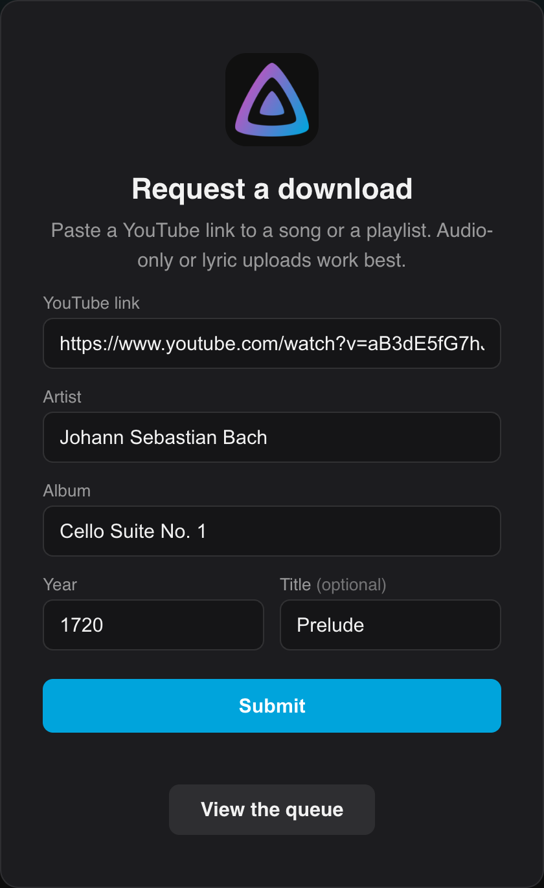

# Approved User Downloads

Let trusted users queue downloads without giving them admin access.

You can allow specific Jellyfin users to submit download links from a simple page, without access to the plugin's admin tabs or the import step.

1. In [Settings](Settings.md), open the **Approved Users** section, select the users you want to allow, and click **Save**.
2. Share the user page with them. It is at `/YouTube/Download` after your server address, such as `https://jellyfin.example.com/YouTube/Download`. Approved users sign in to Jellyfin first, and administrators can always use it.
3. They paste a YouTube link, fill in artist, album, year, and title, and submit it. Artist and album suggest names already in your library as they type. The download then runs on the server and lands in your queue. **View the Queue** opens the [Public Queue](PublicQueue.md).

A playlist link queues each of its videos, up to the **Playlist Limit** set in [Settings](Settings.md) (200 by default). A larger playlist is refused rather than cut short, so the user can ask an administrator to add it.

Approved users can only submit links. They cannot import into the library, and they never see the admin tabs. The page is reachable by its URL, but the submit endpoint checks approval against the signed in Jellyfin account on the server, so an unapproved or signed out visitor cannot queue anything.
