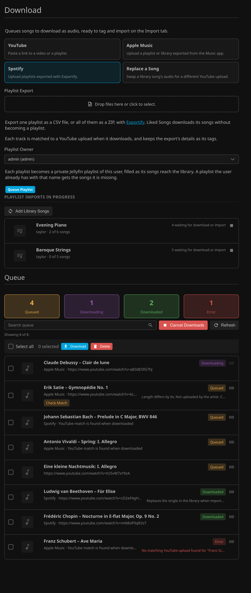

# Download

Queue up audio for download.

## Queue a YouTube Link

1. Choose **YouTube** on the Download tab.
2. Paste a video or playlist link into **YouTube URL**.
3. Click **Queue** to add it to the queue. A playlist link adds each of its videos.

Only `youtube.com`, `www.youtube.com`, `m.youtube.com`, `music.youtube.com` and `youtu.be` links are accepted, and a link containing spaces or quotes is refused.

## The Queue

The **Queue** under the source cards lists every song that is not yet imported. Each song is a card with a music note, its title, and a second line with its source and YouTube link. A playlist track shows its artist before the title, and "YouTube match is found when downloaded" until its upload is matched. Its status badge and the **Change Link** button sit at the top right of the card.

* The status cards above the queue are **Queued**, **Downloading**, **Downloaded** and **Error**, each with its count. Click a card to show only songs with that status, and click it again to show them all. Several cards can be on at once.
* **Search queue** finds songs by title, artist or link.
* Select songs with their checkboxes, or with **Select all**, then click **Download** to download them or **Delete** to remove them. A failed song downloads again when you select it and click **Download**.
* **Refresh** reads the queue again. The queue also refreshes every few seconds while songs download.
* A failed song shows its reason in red on its card. A song worth checking shows a **Check Match** badge and a note, and a song that replaces a library single says "Replaces the single in the library when imported."

## Cancel Downloads

While downloads are running, **Cancel Downloads** appears beside **Search queue**. It stops yt-dlp, deletes the partial files of the song it was downloading and puts that song back in the queue. Songs that had not started stay queued, so you can start them again later. Use it, for example, to stop a large playlist so you can run **Update yt-dlp** in [Settings](Settings.md).

## Import a Playlist From Another Service

1. Choose **Apple Music** or **Spotify** on the Download tab, then export.
    * **Apple Music.** For one playlist, select it in the Music app and choose **File > Library > Export Playlist**, as Unicode Text or XML. For your whole library, choose **File > Library > Export Library**, which lets you pick any of your playlists, or the entire library, in the next step.
    * **Spotify.** Use [Exportify](https://github.com/watsonbox/exportify) to export one playlist as a CSV file, or all of them as a ZIP to pick from in the next step. Playlist names come from the file names. Liked Songs is offered like Apple Music's entire library and does not become a playlist. Spotify's own album cover is embedded, the genre (which Spotify does not export) comes from the Apple Music lookup, and each track's ISRC is used to find its official YouTube upload.
2. Pick the **Playlist Owner**. Each imported playlist becomes a private Jellyfin playlist with the same name, owned by that user (choose "Do not create playlists" to only download). Then drop the file on **Playlist Export**, or click it to choose the file, and click **Queue Playlist**. For a library export, turn off any playlists you do not want and click **Queue Selected**. A track in more than one selected playlist is queued once. Every track is added to the queue with its title, artist, album, genre, composer, year and track and disc numbers from the export (and its album artist, from a library or XML export).
    * Album names are cleaned so every edition groups as one album. Labels like "(Deluxe Edition)", "(Remastered)", "(Bonus Track Version)", " - Single" and " - EP" are removed, while ones naming a different recording ("Live", "Orchestral Version") are kept. "feat." artists are moved out of titles and tagged as featured artists.
    * Nothing is queued twice. Songs already in any of your Jellyfin music libraries or the queue are skipped, and the playlist uses your existing copy. Classical movements count when one side names only the movement. An export's "Suite bergamasque, L. 75: III. Clair de lune" uses your "Clair de lune" by the same artist, and the other way round, as long as the lengths agree and the movement is not just a tempo like "Allegro". A song appearing more than once keeps its best version (album, then compilation, then EP, then single). If your library only has a song's single and the import brings its album version, the album version is queued and the single's file is deleted once it is imported.
    * New tracks from an album you already have reuse that album's name and year, so they land in its existing folder.
    * The owner's playlist fills in as songs reach the library. Songs you already have are added straight away, the rest once they are downloaded, imported and scanned. If the owner already has a playlist with that name, only the songs it is missing are added, and its songs are put in the export's order (songs the owner added themselves keep their place). Each import is one time: it finishes once every song is in, or once a song's download fails or is removed. Importing again later simply adds what is new and reorders.
    * **Playlist Imports in Progress** lists each playlist being filled, with its owner, how many of its songs are in so far, and how many still wait for download or import. **Add Library Songs** adds songs that are already in the library without waiting for a scan. **Stop**, the button on a playlist's card, stops filling it and keeps the Jellyfin playlist and its songs.
3. Download as usual. Each track is matched to a YouTube upload when it downloads, preferring the artist's own channel and an upload close to the track's length. When the regular search only finds music videos of the wrong length (or nothing), YouTube Music's song results are checked too, under the same rules. An upload from another channel is only accepted when its title names the artist, so another performer's recording of the same piece is not picked. For long classical titles ("Suite bergamasque, L. 75: III. Clair de lune"), the movement name is enough to match. A match worth checking (a length difference over 3 seconds, or an upload not from the artist) is marked **Check Match** on its queue row with a note, and a track with no acceptable upload is marked as an error.
4. To fix a wrong or failed match, click **Change Link**, the link button at the top right of its card. Paste the right YouTube link into **YouTube URL** and click **Use Link**. The track downloads again from that link and keeps its title, artist, album and other details, and its place in any playlist import. **Change Link** is greyed out while the song downloads.

## Replace a Song Already in Your Library

If a song reached your library with the wrong audio, choose **Replace a Song** on the Download tab, search for the song under **Library Song** and select it, paste the right YouTube link into **YouTube URL** and click **Queue Replacement**. The new audio downloads with the song's own tags and cover, and importing it from the [Import](Import.md) tab overwrites the song's file in place, so it keeps its place in the library and in playlists.

Next: [Import](Import.md).
