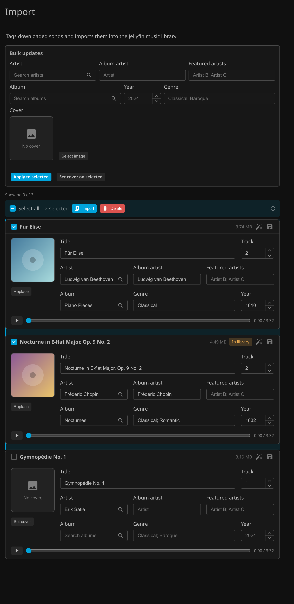

# Import

Tag your downloaded files and bring them into your library.



## Tag and import

1. Each downloaded file has its own panel.
    * The header holds the file's checkbox and title, then its size, an **In library** badge when your library already has the song, the wand that generates a cover, and the save button.
    * The cover sits at the left, with **Set cover**, or **Replace** once the file has a cover, under it.
    * The fields sit beside the cover in three rows. **Title** and **Track**, then **Artist**, **Album artist** and **Featured artists**, then **Album**, **Genre** and **Year**. **Artist** and **Album** suggest names already in your library as you type.
    * The player runs across the full width at the bottom of the panel.
    * On a tablet the cover moves above the fields, and on a phone each field takes its own line.
2. To listen to a file before you tag it, click the play button in its player. The seek bar and the time sit beside it, and starting one file pauses any other.
3. To apply the same details to several files at once, fill in the fields under **Bulk updates**, select the files, and click **Apply to selected**.
4. To add or replace a file's cover, click **Set cover** or **Replace** under it, or drop a picture on it. A cover can be replaced but not removed. To give several files the same cover, choose it under **Cover** in **Bulk updates**, select the files, and click **Set cover on selected**. Pictures are cropped to a centered square of at most 1200 pixels. Choosing an album your library already has takes that album's cover.
5. For an album with no art, click the wand in the panel's header to generate a cover. It is a soft blend of three colors drawn from the album name, with the name in the middle. **Album art** in [Settings](Settings.md#album-art) sets which text it shows and what its colors are drawn from.
6. Save each file's changes with the save button in its header before you import. The button turns orange while a file has unsaved changes.
7. Select the files you want to import, with their checkboxes or **Select all**, and click **Import**. **Delete** deletes the selected files from the download cache after you confirm, and **Refresh** reads the list again.

## Where files go

Metadata is written directly to the audio files. On import, files are copied into your music library directory following Jellyfin's expected structure:

```
<library path>/Artist/Album (Year)/Song.ext
```

Before a file is filed, its artists are tidied. A joint credit such as "Yo-Yo Ma & Kathryn Stott" is stored as separate artists (the album files under the first), while names Apple or your library know as one act, like "Katia & Marielle Labèque", stay whole. Artists already in your library keep the library's spelling, so "LANG LANG" is filed as "Lang Lang".

Existing artist and album folders are reused when the names differ only in case, punctuation or year: "WIENER PHILHARMONIKER" files under "Wiener Philharmoniker", and "GoLdBeRg Variations (1982)" joins "Goldberg Variations (1981)" and takes its name and year. File and folder names avoid characters that network shares and Windows reject (a ":" becomes " - ") and are kept to 100 characters.

Imported files leave the list and the queue.

Next: [Public queue](PublicQueue.md).
