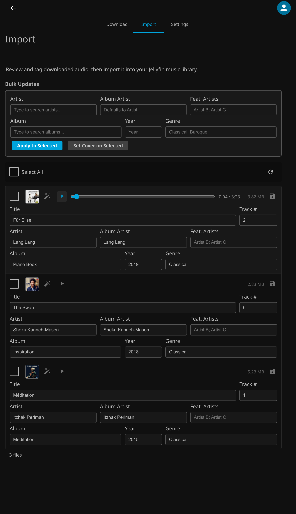

# Import

Tag your downloaded files and bring them into your library.



## Tag and Import

1. Review and edit metadata for each downloaded file (title, artist, album artist, featured artists, album, year, genre, track number). Songs your library already has are marked **Already in your library**, so you can skip a second copy.
2. To apply the same metadata to multiple files at once, fill in the bulk fields at the top and click **Apply to Selected**.
3. To add or replace cover art, click the picture square on a row, or select several files and click **Set Cover on Selected**, then choose an image. Pictures are cropped to a centred square. Choosing an album your library already has takes that album's cover. For an album with no art, click the wand next to **Album** to generate a cover: a soft blend of three colours drawn from the album name, with the name in the middle.
4. Remember to save any unsaved changes on individual tracks before importing (look for the save icon).
5. Select the files you want to import and click **Import**.

## Where Files Go

Metadata is written directly to the audio files. On import, files are copied into your music library directory following Jellyfin's expected structure:

```
<library path>/Artist/Album (Year)/Song.ext
```

Before a file is filed, its artists are tidied. A joint credit such as "Yo-Yo Ma & Kathryn Stott" is stored as separate artists (the album files under the first), while names Apple or your library know as one act, like "Katia & Marielle Labèque", stay whole. Artists already in your library keep the library's spelling, so "LANG LANG" is filed as "Lang Lang".

Existing artist and album folders are reused when the names differ only in case, punctuation or year: "WIENER PHILHARMONIKER" files under "Wiener Philharmoniker", and "GoLdBeRg Variations (1982)" joins "Goldberg Variations (1981)" and takes its name and year. File and folder names avoid characters that network shares and Windows reject (a ":" becomes " - ") and are kept to 100 characters.

Successfully imported files are removed from the queue.

Next: [Public Queue](PublicQueue.md).
