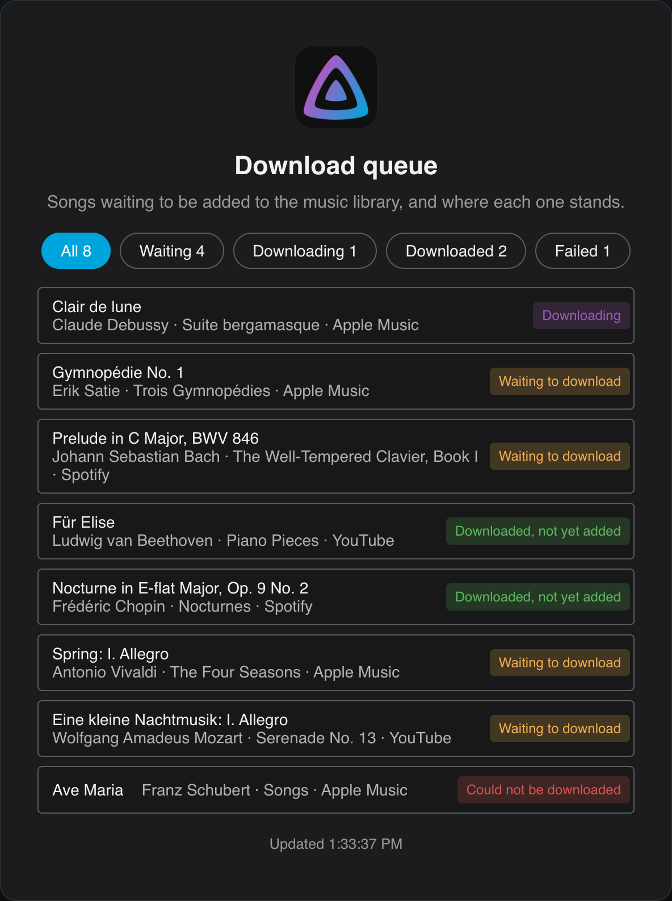

# Public Queue

Let anyone signed in see what's coming.

The Public Queue is at `/YouTube/Queue` after your server address, such as `https://jellyfin.example.com/YouTube/Queue`. Any signed in Jellyfin user can open it, approved or not, to see what is waiting, downloading, downloaded or failed, refreshed every 10 seconds. The pills above the list show one status at a time, each with its count. It is read only and shows titles, artists and albums only: no links, file names or error details.

Next: [Approved User Downloads](ApprovedUserDownloads.md).
