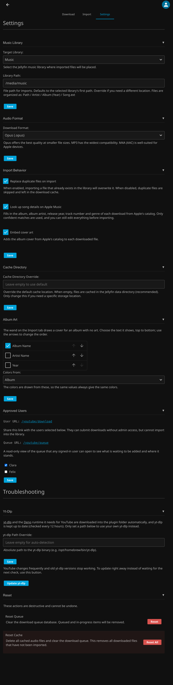

# Settings

Configure the plugin before your first download.



## Music Library

Select your target Jellyfin music library and confirm the library path. This is the directory where imported files will be placed. Files are organized as:

```
<library path>/Artist/Album (Year)/Song.ext
```

!!! important
    Jellyfin must have write access to this directory for the audio to be copied successfully.

## Audio Format

Choose your preferred download format:

| Format | Notes |
| :--- | :--- |
| Opus (.opus) | Best quality at smaller file sizes |
| MP3 (.mp3) | Widest compatibility |
| M4A (.m4a) | Well suited for Apple devices |

## Import Behavior

Choose whether importing a file that already exists in the library should overwrite the existing file or skip it, leaving the duplicate in the download cache. Two more options are on by default:

* **Look up song details on Apple Music.** Each download is looked up in Apple's public music catalog (no account needed) to fill in its title, album, album artist, release year, track and disc numbers and genre. Only a confident match is used: the artist must match and the length must agree. Anything you entered when queueing the song is kept, and playlist imports keep their export's details.
* **Embed cover art.** The album cover from Apple's catalog (as a 1200 × 1200 square) is added to each downloaded file, so Jellyfin shows it.

## Cache Directory

By default, downloaded files are cached in the Jellyfin data directory. Override this if you need a specific staging location.

## Approved Users

By default, only users with access to the Admin Dashboard can download and import tracks. Enabling a user here allows select users to download tracks into your queue, which you can then approve and import into your library. See [Approved User Downloads](ApprovedUserDownloads.md).

Next: [Download](Download.md).
