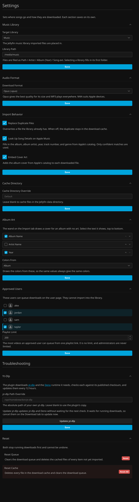

# Settings

Configure the plugin before your first download.



Each section opens with a click on its title and saves on its own. The full width **Save** at the end of a section saves only that section. The line above it says when the section has unsaved changes, and whether the save worked.

## Music Library

Choose your Jellyfin music library under **Target Library**. **Library Path** fills in with that library's first folder, and you can change it. Imported files are placed in this folder, organized as follows.

```
<library path>/Artist/Album (Year)/Song.ext
```

!!! important
    Jellyfin must have write access to this directory to copy the audio into it.

## Audio Format

Choose the format songs download as under **Download Format**.

| Format | Notes |
| :--- | :--- |
| Opus (.opus) | Best quality at smaller file sizes |
| MP3 (.mp3) | Widest compatibility |
| M4A (.m4a) | Well suited for Apple devices |

## Import Behavior

**Replace Duplicate Files** decides whether importing a song that is already in the library overwrites the existing file or skips it, leaving the duplicate in the download cache. A file with the same name counts as a duplicate unless both songs carry track numbers and they differ: a different song that shares its title with one on the same album, like a second "Interlude" with its own track number, is imported beside it as "Title (2).ext" and never overwrites it. A re-download of the same song from another upload is still a duplicate. Two more options are on by default:

* **Look Up Song Details on Apple Music.** Each download is looked up in Apple's public music catalog (no account needed) to fill in its title, album, album artist, release year, track and disc numbers and genre. Only a confident match is used: the artist must match and the length must agree. Anything you entered when queueing the song is kept, and playlist imports keep their export's details.
* **Embed Cover Art.** The album cover from Apple's catalog (as a 1200 × 1200 square) is added to each downloaded file, so Jellyfin shows it.

## Cache Directory

By default, downloaded files are cached in the Jellyfin data directory. Override this if you need a specific staging location.

## Album Art

These settings shape the cover the wand on the [Import](Import.md) tab generates for an album with no art.

* The text list sets which lines the cover shows, top to bottom. Turn **Album Name**, **Artist Name** and **Year** on or off, and move a line up or down with the arrows beside it. Only **Album Name** is on by default.
* **Colors From** sets what the colors are drawn from, **Album**, **Album and year**, or **Album artist and year**. The same values always give the same colors.

## Approved Users

By default, only users with access to the Admin Dashboard can download and import tracks. Turn on a user here to let them queue downloads into your queue from the user page, which you can then import into your library. They cannot import themselves. Administrators are not listed, since they can always use the page. See [Approved User Downloads](ApprovedUserDownloads.md).

The Settings tab shows no links to the user pages. Share their addresses yourself. Each is your server address followed by its path.

| Page | Address | Who can use it |
| :--- | :--- | :--- |
| User page | `https://jellyfin.example.com/YouTube/Download` | Approved users and administrators |
| [Public Queue](PublicQueue.md) | `https://jellyfin.example.com/YouTube/Queue` | Any signed in user |

**Playlist Limit** caps how many videos an approved user can queue from one playlist link (200 by default). A larger playlist is refused with a message asking them to have an administrator add it. Set it to 0 for no limit. Administrators are never limited.

## yt-dlp

The plugin downloads [yt-dlp](https://github.com/yt-dlp/yt-dlp) and the [Deno](https://deno.com) JavaScript runtime that yt-dlp needs for YouTube into the plugin folder the first time they are needed, from their official GitHub releases. Both are kept up to date. Every 12 hours, before a download starts, the plugin checks for newer releases and replaces its own copies. Every file is checked against the SHA-256 checksum published with its release before it is made executable, `SHA2-256SUMS` for yt-dlp and `.sha256sum` for Deno. A file that does not match is deleted and never run, and the error says so.

* **yt-dlp Path Override.** Set an absolute path (for example `/opt/homebrew/bin/yt-dlp`) to use your own yt-dlp instead. The plugin then never downloads or replaces yt-dlp, and **Update yt-dlp** runs that binary's own updater (`yt-dlp -U`). A system yt-dlp is otherwise only used when the plugin's own copy cannot be downloaded. A Deno installed on the system is used when the plugin has no copy of its own, and is never updated by the plugin.
* **Update yt-dlp.** Updates yt-dlp and the plugin's Deno right away instead of waiting for the next check. It sits above the section's **Save**, and its result shows on the line above **Save**. It waits for running downloads, so cancel them on the [Download](Download.md) tab to update now.

## Reset

Both actions stop any running downloads first and cannot be undone. Each asks you to confirm first.

* **Reset Queue**, with its **Reset** button, clears the download queue and deletes the cached files of every queued, failed and downloaded item that has not been imported.
* **Reset Cache**, with its **Reset All** button, deletes every file in the download cache and clears the download queue.

Files left in the cache by an interrupted download (for example when the server stopped mid-download) are removed automatically the next time the server starts, and songs that were downloading go back to the queue.

Next: [Download](Download.md).
